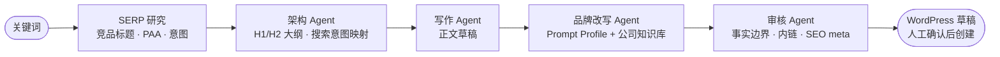

# SEO Content Workflow · Demo

> 从**一个英文关键词**到**一篇可发布 SEO 草稿**的多智能体内容流水线。
> 本仓库是生产系统的**脱敏教学版**:架构模式与工程边界与生产一致,代码为公开重写,不包含任何客户数据、业务提示词与密钥。


---

## 它解决什么问题

外贸内容生产的瓶颈不是"写一篇文章",而是**每一步都可复核**:

> 选题依据是否来自真实 SERP?结构是否覆盖搜索意图?通用行业稿如何改写成客户品牌稿?发布前谁来把关?

这条流水线把内容生产拆成 6 个可独立检查的阶段,每个阶段产出**结构化中间产物(artifact)**,人工可以在任意阶段介入,而不是面对一个黑盒。



**人工边界是设计的一部分**:流水线默认只产出 `preview` 产物;WordPress 草稿只在人工确认后,通过独立的二次动作创建——系统从不自动发布。

## 快速开始(无需 API Key)

```bash
git clone https://github.com/1-1-1-11/seo-content-workflow-demo.git
cd seo-content-workflow-demo

python -m venv .venv && source .venv/bin/activate   # Windows: .venv\Scripts\activate
pip install -r requirements.txt

# Mock 模式:内置确定性假数据,完整跑通 6 个阶段
python -m seo_demo.run --keyword "industrial gearbox motor" --mode mock
```

运行后在 `artifacts/<run_id>/` 查看每个阶段的中间产物:

```text
artifacts/20260729_153000_gearbox/
├── 01_serp.json        # SERP 研究结果:竞品标题、PAA 问题、搜索意图
├── 02_outline.json     # 文章大纲:H1/H2 结构与意图映射
├── 03_draft.md         # 初稿
├── 04_brand_draft.md   # 按 prompt profile 改写后的品牌稿
└── 05_audit.json       # 审核结果:通过项 / 需人工处理项
```

## 三种运行模式

| 模式 | 行为 | 用途 |
|---|---|---|
| `mock` | 内置确定性数据,不调用任何外部 API | 演示、CI、单元测试 |
| `preview` | 调用真实 SERP/LLM API,只产出本地产物 | 日常生产 |
| `publish` | 在 `preview` 基础上,人工确认后创建 WordPress 草稿 | 发布(二次动作) |

## 品牌改写:Prompt Profile + 公司知识库

通用行业稿 → 客户品牌稿,靠两份**与客户代码分离**的配置:

```yaml
# config/prompt_profile.example.yaml
brand_voice: "technical, plain-spoken, no hype"
company_kb:
  positioning: "OEM industrial motor manufacturer, 20 years"
  differentiators: ["IE3/IE4 full range", "OEM customization", "48h quote response"]
  forbidden_claims: ["largest", "No.1", "guaranteed"]   # 审核 Agent 会拦截
```

`forbidden_claims` 由审核 Agent 强制执行——**营销词不是"建议不用",是"写了就过不了审"**。

## 工程要点

| 设计 | 说明 |
|---|---|
| 显式状态机 | LangGraph `StateGraph`,阶段即节点,产物即状态;新增阶段 = 加一个节点,不改动既有节点 |
| 全链路结构化 | 阶段间传递 Pydantic 模型而非裸文本,schema 变化在类型层暴露 |
| 每阶段可复核 | 所有中间产物落盘为 artifact,支持"只重跑某一阶段" |
| 失败边界 | LLM 输出解析失败 → 该阶段标记失败并保留原始输出,不静默降级、不伪造结果 |
| 可测试 | Mock 模式全链路确定性,CI 中不依赖任何外部服务 |

## 目录结构

```text
src/seo_demo/
├── state.py          # WorkflowState:贯穿流水线的显式状态
├── models.py         # SerpResult / Outline / AuditReport 等 Pydantic 模型
├── mock_llm.py       # 确定性假 LLM:mock 模式与测试使用
├── nodes.py          # 6 个阶段节点的实现
├── graph.py          # StateGraph 装配:节点、边、入口
└── run.py            # CLI 入口:--keyword --mode
config/
└── prompt_profile.example.yaml
tests/
└── test_pipeline.py  # 全链路 mock 测试 + 审核拦截测试
```

## 与生产版本的差异

| 维度 | 生产版本(实习期间开发) | 本 Demo |
|---|---|---|
| 流水线规模 | 8 节点(含选题排序、配图提示词、发布载荷) | 6 节点,保留核心链路 |
| 操作界面 | Streamlit 操作台 + 多客户管理后台 | CLI |
| 部署 | Docker Compose 多客户隔离部署,GitHub Actions CI | 本地运行 |
| 数据 | 真实 SerpAPI、客户知识库、WordPress 站点 | Mock 数据、示例 profile |

## 截图

见 [`assets/`](assets/)——生产环境操作台与产物截图(已脱敏)。

---

*Demo code is a public rewrite of architecture patterns from a production system; no client data, prompts, or credentials included.*
