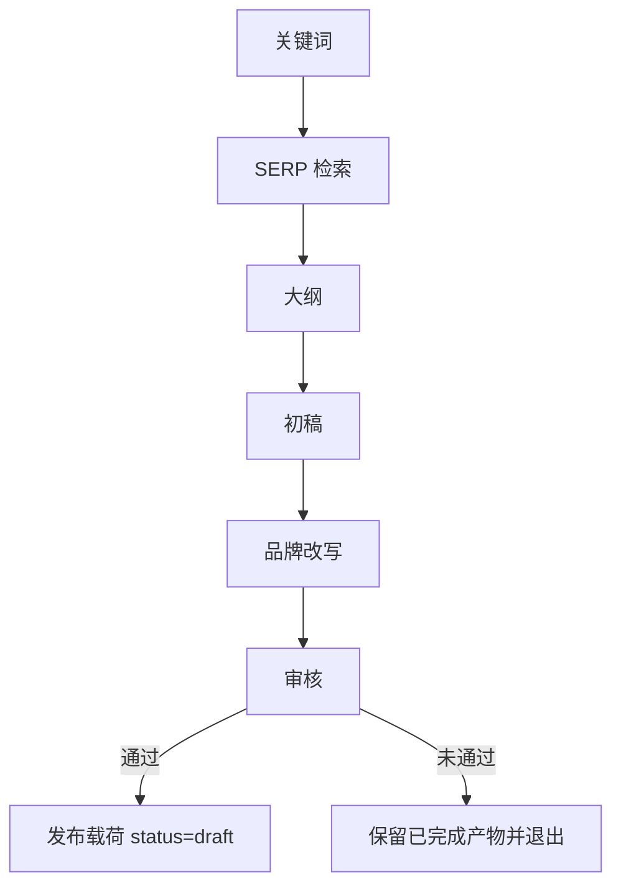
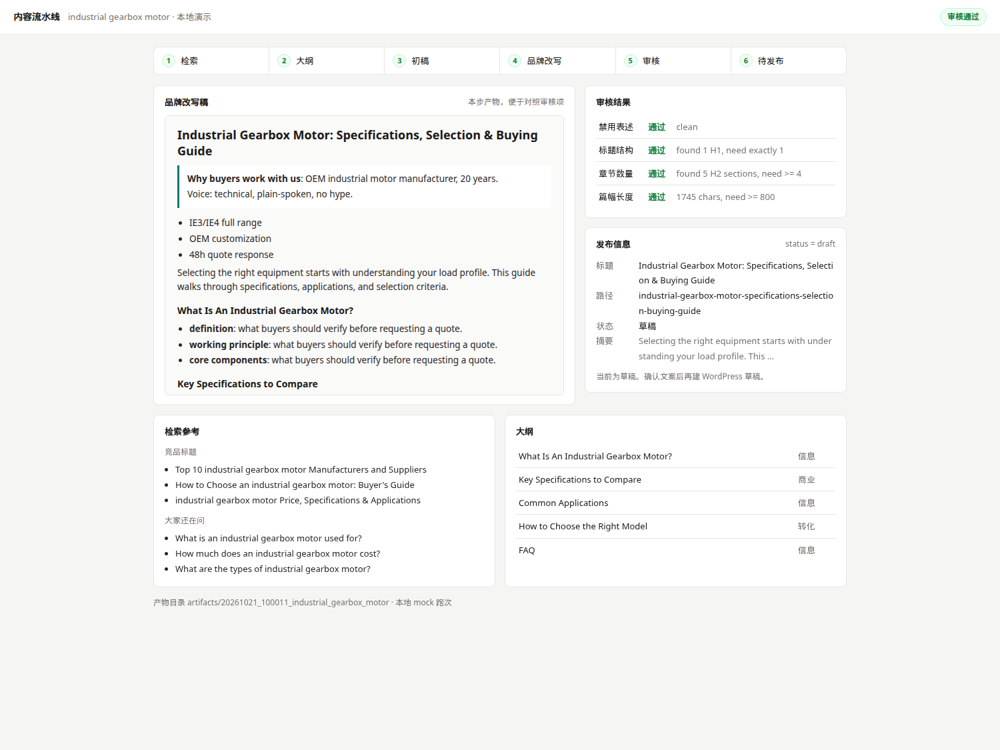

# seo-content-workflow-demo

Offline LangGraph demo: a keyword goes in, and a checked SEO draft comes out. No network calls.

外贸站 SEO 内容流水线的脱敏演示。输入一个关键词，依次得到检索摘要、大纲、初稿、品牌改写稿、审核结果，以及一份**不会自动发布**的 WordPress 草稿载荷。客户数据、真实提示词和密钥不在这个仓库里。本地 mock 就能跑完。

## 它做什么

每个阶段只做一件事：读上一步的状态，写出结构化产物，失败时留下原始输出并停住。品牌怎么说话来自独立的 profile（语气、定位、差异点、禁用词），不写在节点代码里。审核里的 `forbidden_claims` 是硬拦截，写中了就不会生成发布载荷。

`preview` 和 `publish` 在本仓库中没有真实客户端。这两种模式会明确提示后继续走 mock，载荷的 `status` 保持 `draft`。

## 流程



| 步骤 | 节点 | 产物 |
| --- | --- | --- |
| 检索 | `serp_research` | `01_serp.json` |
| 大纲 | `architecture` | `02_outline.json` |
| 初稿 | `write_article` | `03_draft.md` |
| 品牌改写 | `brand_rewrite` | `04_brand_draft.md` |
| 审核 | `audit` | `05_audit.json` |
| 发布载荷 | `publish_prepare` | `06_publish_payload.json` |

审核没过时不会写 `06_publish_payload.json`，前面的文件和 `error_publish_prepare.txt` 会留下来。

## 快速开始

需要 Python 3.11+。

```bash
git clone https://github.com/1-1-1-11/seo-content-workflow-demo.git
cd seo-content-workflow-demo
python -m venv .venv
source .venv/bin/activate
pip install -e ".[dev]"
cp .env.example .env
python -m seo_demo.run --keyword "industrial gearbox motor"
```

只装运行时依赖时，用 `pip install -r requirements.txt`，并从仓库根目录以 `PYTHONPATH=src` 运行。安装完成之后也可以用 `seo-demo --keyword "industrial gearbox motor"`。

把最近一次完整跑次渲成单页报告：

```bash
python gen_report.py
# 打开 assets/_run_report.html。这个文件已被 gitignore。
```



## 环境变量

复制 `.env.example` 为 `.env`。`.env` 不会被提交。已经导出的环境变量优先于文件；命令行优先于环境变量。

| 变量 | 默认 | 作用 |
| --- | --- | --- |
| `SEO_DEMO_KEYWORD` | 无 | 关键词。`--keyword` 可以覆盖它 |
| `SEO_DEMO_MODE` | `mock` | `mock`、`preview` 或 `publish`。后两者不会出网 |
| `SEO_DEMO_PROFILE` | `config/prompt_profile.example.yaml` | 品牌配置路径 |
| `SEO_DEMO_OUT` | `artifacts` | 产物目录 |
| `SEO_DEMO_ENV_FILE` | `.env` | 可选，改读别的 env 文件 |

示例 profile 在 `config/prompt_profile.example.yaml`。改 `brand_voice`、`positioning`、`differentiators` 和 `forbidden_claims` 即可换一套口径。里面的公司描述是虚构的。

`.env.example` 里被注释掉的 LLM、SERP 和 WordPress 变量只是占位符。这个演示不会读取它们。

## 示例输出

```text
run_id : 20261021_120000_industrial_gearbox_motor
keyword: industrial gearbox motor
audit  : PASSED
payload: title='Industrial Gearbox Motor: Specifications, Selection & Buying Guide' slug='industrial-gearbox-motor-specifications-selection-buying-guide'
artifacts -> artifacts/20261021_120000_industrial_gearbox_motor/
```

`06_publish_payload.json` 里和发布有关的字段：

```json
{
  "title": "Industrial Gearbox Motor: Specifications, Selection & Buying Guide",
  "slug": "industrial-gearbox-motor-specifications-selection-buying-guide",
  "meta_description": "Selecting the right equipment starts with understanding your load profile. This guide walks through specifications, applications, and selection criteria.",
  "status": "draft"
}
```

`meta_description` 取的是正文导语，不是品牌引用块。审核结果：

```json
{
  "passed": true,
  "checks": [
    {"name": "forbidden_claims", "ok": true, "detail": "clean"},
    {"name": "has_h1", "ok": true, "detail": "found 1 H1, need exactly 1"},
    {"name": "min_sections", "ok": true, "detail": "found 5 H2 sections, need >= 4"},
    {"name": "min_length", "ok": true, "detail": "1745 chars, need >= 800"}
  ]
}
```

退出码：`0` 审核通过，`1` 流水线失败或审核拦住，`2` 缺少关键词或 profile 无法读取。

## 开发

```bash
ruff check .
pytest
```

贡献和报告安全问题见 [CONTRIBUTING.md](CONTRIBUTING.md) 和 [SECURITY.md](SECURITY.md)。版本记录见 [CHANGELOG.md](CHANGELOG.md)。

```text
src/seo_demo/
  state.py  models.py  nodes.py  graph.py
  run.py  mock_llm.py  profile.py  textutil.py  dotenv.py
config/prompt_profile.example.yaml
tests/
```

## 许可证

[MIT](LICENSE)
